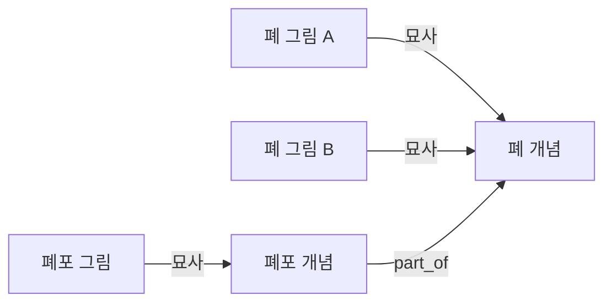
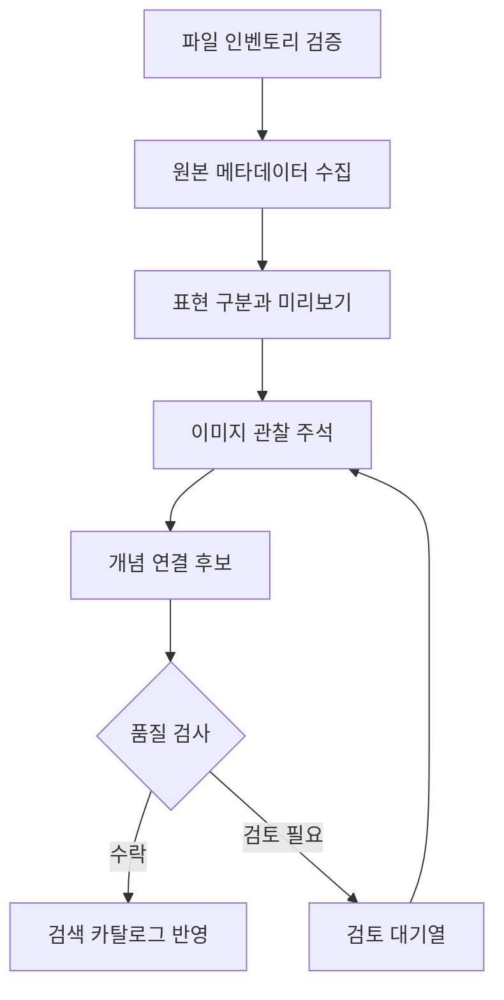
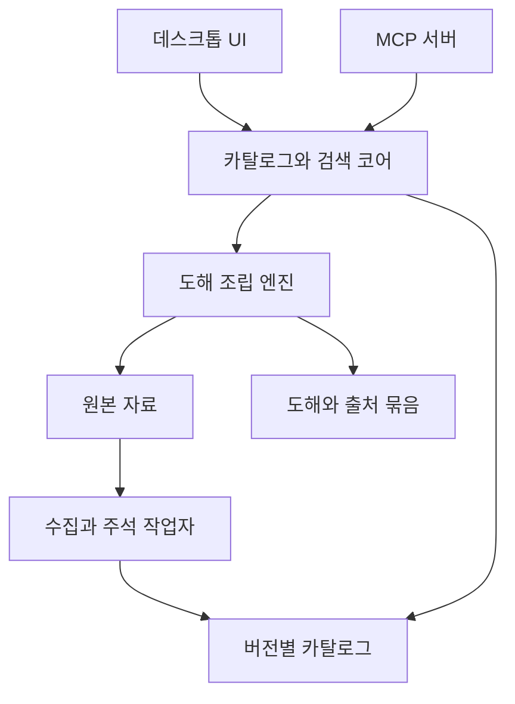

# BioArt Browser 구현 계획서

_작성일: 2026-09-24 · 버전: 0.1 · 상태: 설계안 · 범위: 이미지 내용 정리, 개념 기반 탐색, MCP 연동, 도해 조립_

이 문서는 BioArt 그림을 정확한 키워드 없이도 발견하고, AI agent가 필요한 자산을 찾아 실제 도해 제작에 사용할 수 있도록 만드는 구현 계획이다. 앞선 사용자·Codex 토론을 바탕으로 작성했으며, 구현 및 전체 이미지 주석 작업은 아직 시작하지 않았다. 아래의 도구 이름, 데이터 필드, 성능 기준은 구현 목표이며 현재 제공되는 기능을 뜻하지 않는다.

첫 작업은 각 그림의 내용을 정리하는 것이다. 파일명·다운로드 JSONL은 자산 식별과 무결성 확인에 활용하고, 원본 설명과 실제 이미지 관찰을 결합해 검색에 필요한 의미 정보를 별도로 구축한다.

---

## 🎯 1. 제품 목표와 설계 원칙

### 1.1 해결할 문제

현재 사용자가 제기한 문제는 정확한 검색어를 미리 알아야 원하는 clipart를 찾을 수 있다는 것이다. 사용자는 `lung`만 알고 있어도 `alveoli` 그림을 발견하고, 더 나아가 “폐에서 산소가 혈액으로 이동하는 과정을 보여주고 싶다”는 설명으로 도해에 필요한 재료를 찾을 수 있어야 한다.

제품은 다음 세 가지 작업을 지원한다.

| 작업 | 사용자의 입력 | 기대하는 결과 |
| --- | --- | --- |
| 발견 | 키워드, 일상적 설명, 한국어 문장 | 직접 일치 및 관련 그림을 이유와 함께 제시 |
| 탐색 | 관심 있는 그림 또는 개념 선택 | 전체·부분·종류·과정 관계를 따라 이동 |
| 제작 | “BioArt를 최대한 활용해 이런 그림을 만들어줘” | 적절한 자산을 사용한 편집 가능한 도해와 출처 목록 |

사람이 사용하는 UI와 AI가 사용하는 MCP는 동일한 카탈로그·검색·관계 엔진을 사용한다. 검색과 도해 제작은 별도의 단계로 구현하되, 처음부터 자산 ID와 도해 문서 형식을 공유하도록 설계한다.

### 1.2 주요 결정

| 결정 | 이유 |
| --- | --- |
| 자산과 생물학적 개념을 분리한다 | 같은 개념의 여러 그림을 일관되게 찾고 확장하기 위해 |
| 항목·표현 변형·파일을 구분한다 | 동일 작품의 PNG·SVG와 색상 변형이 검색 결과를 독점하지 않도록 |
| 관계에 종류·방향·근거를 저장한다 | “관련 있다”의 의미를 사용자와 AI가 판단할 수 있도록 |
| 원본 정보·시각 관찰·추론을 구분한다 | AI가 추정한 정체성이나 기능을 사실로 굳히지 않도록 |
| 한국어·영어를 같은 개념에 연결한다 | 정확한 영어 명칭 없이도 탐색하도록 |
| 로컬 원본 보존과 재시작 가능한 처리를 기본으로 한다 | 대량 작업 중 실패와 후속 재분석에 대응하도록 |
| 관계별 갤러리를 기본 UI로 사용한다 | 그림을 고르는 작업을 중심에 두기 위해 |
| 제한된 도해 구도부터 지원한다 | 생성 결과의 가독성과 수정 가능성을 검증하기 위해 |

### 1.3 초기 범위에서 제외할 사항

- 사용자 행동을 대규모로 수집하는 개인화 추천과 협업 필터링
- 전체 생물학 지식을 자체 구축하는 거대한 지식 그래프
- 자유로운 과학 도해를 제한 없이 자동 완성한다는 보장
- SVG 내부 경로를 세포·소기관 등 의미 단위로 자동 분해하는 기능
- 원본 clipart를 생성형 이미지로 다시 그려 대체하는 기능
- 실시간 다중 사용자 협업, 원격 MCP 공개 운영, 대규모 클라우드 배포

이 항목들은 후속 확장 후보이며, 첫 구현의 완료 조건에 포함하지 않는다.

## 📦 2. 현재 자료와 정보 부족 분석

### 2.1 확인한 로컬 상태

2026-09-24에 작업 폴더를 읽어 확인한 스냅샷이다. 전체 파일의 무결성을 이번 계획 작성 중 다시 검사한 것은 아니다.

| 항목 | 확인 결과 |
| --- | --- |
| 작업 경로 | `/Volumes/Aquatope/_DEV_/BioArt_Browser` |
| 원본 자료 폴더 | `BioArt_PNG_SVG/` |
| 기존 앱 소스 | 현재 작업 폴더에서 확인되지 않음 |
| 다운로드 manifest | `download-list.csv`, 9,525행 |
| 고유 BioArt 항목 | manifest의 `bioart_id` 기준 933개 |
| 존재하는 PNG | 4,760개 |
| 존재하는 SVG | 4,764개 |
| 다운로드 로그 | `download-results.jsonl`, 9,525개 레코드 |
| 로그상 성공·실패 | 성공 9,524개, 실패 1개 |
| 항목별 라이선스 표기 | Public Domain 905개, CC-BY 28개 |

실패 항목은 `Point-of-Care MRI System`, `bioart_id=689`, SVG `file_id=782376`이다. 해당 `.svg.part`가 남아 있다. 인벤토리에서 미완료로 명시하고 재다운로드 작업으로 분리한다. `.part` 파일은 검색·미리보기·내보내기 자산에 포함하지 않는다.

`status.json`에는 이전 다운로드 위치인 `/Volumes/Aquatope/Downloads/BioArt_PNG_SVG`가 기록되어 있다. 현재 경로는 설정한 자료 루트를 기준으로 해석하고, 이전 절대 경로를 그대로 사용하지 않는다.

### 2.2 기존 데이터가 알려주는 것

CSV의 필드는 `bioart_id`, `title`, `format`, `file_id`, `license`, `download_url`이다. JSONL은 여기에 상대 경로, 결과, 파일 크기, 체크섬, 완료 시각, 실패·재시도 정보를 추가한다. 필드는 성공·실패 레코드에 따라 다를 수 있다.

| 필요한 정보 | 파일명·현재 CSV/JSONL에서 확보 가능 여부 |
| --- | --- |
| 어떤 항목의 어떤 파일인지 | 가능 |
| 원본 제목과 다운로드 주소 | 가능 |
| 파일 형식·크기·성공 여부·체크섬 | 로그를 통해 대부분 가능 |
| 그림이 실제로 보여주는 구조와 배치 | 부족 |
| 원본 설명·키워드·세부 분류·제작자 | 현재 다운로드 목록에 없음 |
| 정면·측면·단면·확대도 여부 | 직접적인 필드 없음 |
| 같은 항목의 PNG와 SVG가 어떤 표현끼리 대응하는지 | 파일 ID만으로 확정할 수 없음 |
| 한국어 명칭·동의어·상위 개념 | 없음 |
| 다른 그림과의 생물학적 관계 및 근거 | 없음 |
| 어떤 도해에 적합한지 | 없음 |

문제는 JSONL 형식 자체가 아니라 현재 저장한 필드의 범위다. 새로운 주석도 JSONL로 보존할 수 있지만, 다운로드 로그를 의미 데이터 저장소로 덮어쓰지는 않는다.

### 2.3 원본 사이트에서 보강할 정보

원본 BioArt 페이지에는 현재 CSV보다 풍부한 정보가 있다. 확인한 Human Lungs 페이지에는 설명, 키워드, 제작자, credit, collection, 해부학 분류가 존재한다.[^bioart_lungs] 항목마다 필드가 다를 수 있으므로 누락을 허용해야 한다.

수집 대상은 원본 항목 ID, canonical URL, 제목, 설명, 키워드, 분류, representation 정보, 제작자, collection, credit, 라이선스 이름·URL, 생성·수정 시각이다.

URL의 숫자만으로 항목 정체성을 확정하지 않는다. 계획 조사 중 `/bioart/567`을 열었을 때 응답 본문은 `BIOART-000575 / White Pulp`를 표시한 사례가 있었다. 원인은 아직 규명하지 않았으며, 사이트 데이터 변경이라고 단정하지 않는다. 수집 시 요청 ID·응답 ID·제목·canonical URL을 대조하고 불일치는 검토 대상으로 격리한다.

## 🧬 3. 데이터 모델과 그림 내용 카드

### 3.1 데이터 계층

| 계층 | 주요 필드 | 관계 |
| --- | --- | --- |
| Concept | 내부 ID, 영문·국문명, 별칭, 개념 유형, 외부 ontology ID | 여러 그림에서 공통 사용 |
| Artwork | 내부 ID, 원본 BioArt ID, 제목, 원본 설명, 출처 | 하나 이상의 표현을 포함 |
| Representation | ID, 그림 내용 카드, 시점, 스타일, 변형 근거 | 하나 이상의 파일과 연결 |
| AssetFile | 원본 file ID, 형식, 상대 경로, 크기, 체크섬, 유효성 | 특정 표현의 실제 파일 |
| DepictionAssertion | 표현 ID, 개념 ID, 묘사 역할, 근거, 검토 상태 | 무엇이 실제로 묘사되었는지 연결 |
| ConceptRelation | 출발 개념, 관계, 도착 개념, 근거, 적용 문맥 | 전체·부분·종류·과정 관계 |
| UsageSuggestion | 표현 또는 자산 집합, 활용 주제, 이유, 근거 | 도해 사용 제안이며 생물학적 사실과 분리 |

원본 `file_id`를 representation ID로 간주하지 않는다. 원본 representation 식별자가 없다면 파일별 임시 표현으로 등록한 뒤, 원본 정보와 시각 비교로 대응 관계를 확인한다. 제목이나 파일 번호의 근접성만으로 자동 병합하지 않는다.

하나의 그림은 여러 개념을 묘사할 수 있다. 주 대상, 부수적으로 보이는 구조, 명시된 라벨을 구별한다. 설명에 등장하는 모든 단어를 ‘그림에 그려져 있는 개념’으로 등록하지 않는다.



### 3.2 그림 내용 카드의 필수 항목

주석의 기본 단위는 representation이다. Artwork 공통 설명은 상속할 수 있지만, 실제 화면에 보이는 차이는 표현별로 기록한다.

| 영역 | 기록할 내용 | 주의점 |
| --- | --- | --- |
| 식별 | artwork·representation·file ID, 입력 체크섬 | 입력 자산이 바뀌면 재검토 |
| 짧은 설명 | 검색 결과에서 읽을 1~2문장 | 관찰·원본 근거를 넘어서는 기능 단정 금지 |
| 주요 대상 | 중심 개체·조직·기관·장비 | 모호하면 더 넓은 개념 또는 unknown |
| 포함 요소 | 관찰 가능한 부수 구조, 객체 수, 위치 | 제목만 보고 보이지 않는 구조를 추가하지 않음 |
| 명시된 글자 | 그림 속 라벨·기호·텍스트 | OCR 또는 시각 판독 결과와 불확실성 보존 |
| 표현 방식 | 단면·정면·측면·확대 삽화·과정도 등 | 의미 없는 이미지에는 not_applicable |
| 시각 속성 | 채색, 선, 입체감, 배경, 여백, 방향 | 관찰과 기계 측정을 구분 |
| 생물학적 문맥 | 종, 조직, 세포형, 상태 | 원본 또는 검증된 근거가 있을 때 명시 |
| 검색어 | 한영 이름, 동의어, 설명형 검색 문구 | 단순 관련어와 동의어를 구분 |
| 활용 제안 | 설명에 쓸 수 있는 주제·구도 | 사실 주석과 다른 필드에 저장 |
| 제한 | 가려진 구조, 합성하기 어려운 배경, 모호한 정체성 | 관련 분야의 다른 그림으로 오인하지 않도록 |
| 근거·품질 | 원본 스냅샷, 관찰 입력, 모델·프롬프트 버전, 검토 이력 | 필드별 추적 가능해야 함 |

### 3.3 관찰과 추론을 구별하는 규칙

각 assertion에는 `evidence_type`, `evidence_ref`, `review_status`를 저장한다.

| evidence_type | 의미 |
| --- | --- |
| `source_metadata` | 원본 페이지·API에 명시된 정보 |
| `visual_observation` | 제공한 이미지에서 관찰한 형태·구성 |
| `ontology_assertion` | 특정 버전의 온톨로지에서 가져온 관계 |
| `model_inference` | AI가 제안한 정체성·문맥·연결 |
| `human_annotation` | 검토자가 직접 작성·수정한 정보 |

`review_status`는 `unreviewed`, `accepted`, `rejected`, `needs_review`, `superseded`를 기본으로 한다. 원본에 적혀 있다는 사실과 사람이 검토했다는 사실은 별개이므로 근거 유형으로 검토 상태를 대신하지 않는다. `accepted`로 바뀔 때 누가 어떤 규칙이나 검토로 수락했는지 기록한다.

모델이 출력한 confidence를 보정된 확률로 취급하지 않는다. 원본과의 일치, 필수 정보 누락, 복수 후보, 시각적 모호성, 수동 평가 결과를 이용해 검토 우선순위를 계산한다.

확인할 수 없는 정보는 `unknown`, 해당되지 않는 정보는 `not_applicable`, 확인하지 않은 정보는 `not_assessed`로 구분한다. 비어 있는 값을 부재의 증거로 해석하지 않는다.

### 3.4 주석 저장 계약 예시

아래 JSON은 스키마 설명용 가상 레코드다. 실제 BioArt 그림을 분석한 결과가 아니다.

```json
{
  "schema_version": "0.1",
  "representation_id": "example_rep_001",
  "input_file_ids": ["example_file_001"],
  "input_fingerprint": "example_input_fingerprint",
  "annotation_run_id": "example_run_001",
  "summary_ko": "원본과 이미지를 확인한 후 작성한다.",
  "assertions": [
    {
      "field": "primary_concept",
      "value": "example_concept_lung",
      "evidence_type": "source_metadata",
      "evidence_ref": "example_snapshot_001",
      "review_status": "unreviewed"
    }
  ],
  "usage_suggestions": [],
  "unresolved_questions": ["표현별 이미지 확인이 필요하다."],
  "annotation_status": "pending_visual_review"
}
```

## 🔍 4. 그림 내용 정리 파이프라인

### 4.1 전체 처리 흐름



### 4.2 인벤토리와 원본 보존

1. CSV·JSONL·실제 디렉터리를 대조해 누락·중복·손상·미완료를 분류한다.
2. 로그에 체크섬이 있으면 파일을 다시 읽어 비교하고, 없으면 새 체크섬을 산출한다.
3. PNG 디코딩과 SVG 파싱·렌더링을 별도로 검증한다. XML 파싱 성공만으로 미리보기 가능성을 보장하지 않는다.
4. 원본 폴더는 입력 자료로 보존하고 주석·썸네일·DB는 별도 경로에 쓴다.
5. 원본이 이동하면 루트 설정과 상대 경로로 복구한다. 파일명만으로 동일성을 판단하지 않는다.
6. 실패한 SVG 한 건은 원인 확인 후 재다운로드하고, 대체 PNG가 있으면 그 존재를 카탈로그에 명시한다.

모든 원본 파일을 성공적으로 복구할 때까지 전체 프로젝트를 중단하지 않는다. 사용 불가능한 파일을 제외한 나머지 자산은 다음 단계로 진행한다.

### 4.3 메타데이터 수집

- 우선 원본 사이트의 실제 데이터 제공 방식과 이용 조건을 확인한다. 이 문서는 비공개 API 경로나 응답 스키마를 가정하지 않는다.
- 응답 원문과 요청 URL, 응답·canonical ID, 수집 시각, 내용 해시를 저장한다.
- 요청 속도 제한, 백오프, 부분 실패 재시도, 캐시를 적용한다.
- 원본 항목과 다른 내용이 반환되면 자동 결합하지 않는다.
- 라이선스 이름·버전·URL·credit을 확보하지 못하면 미확인 상태로 남긴다.
- 원문과 정규화된 필드를 모두 유지한다. 후속 파서 수정으로 다시 처리할 수 있어야 한다.

### 4.4 표현 구분과 시각적 준비

원본 representation 정보를 우선 사용하고, PNG·SVG 렌더링 비교는 보조 증거로 활용한다. 원본 연결 정보가 없을 때는 시각적 유사도로 대응 후보를 생성하되, 단순 파일 확장자나 이름만으로 확정하지 않는다.

각 표현의 썸네일, 필요 시 고해상도 분석 이미지, 실제 그림 영역의 bounding box, 투명도·크기 정보를 만든다. 흰색 선이나 반투명 구조를 놓치지 않도록 밝은 배경과 어두운 배경을 지원한다.

내용이 동일하다고 확인된 포맷 쌍은 중복 분석을 줄일 수 있다. 색상만 다른 표현도 상태·범례·강조의 차이를 나타낼 수 있으므로, 자동으로 동일 의미라고 가정하지 않는다. 구조나 시점이 다른 표현은 각각 분석한다.

### 4.5 파일럿 주석

전체 배치 전에 50~100개 representation을 선정한다. 표본은 호흡계·면역계뿐 아니라 장비, 분자, 생물, 다중 객체, 글자가 포함된 도해, 단순 화살표·배경 요소, 모호한 그림을 포함한다.

파일럿에서 다음을 결정한다.

- 그림 내용 카드 필드의 유용성과 입력 이미지 해상도
- 이미지·원본 설명을 함께 제공하는 프롬프트와 결과 스키마
- 원본 설명을 먼저 보았을 때 생기는 과도한 추정의 처리 방식
- 한국어 설명과 영문 개념명 생성 품질
- 표현당 처리 시간, 입력·출력 토큰, 재시도율, 검토 소요 시간
- 분석 모델과 embedding 후보의 실제 품질·비용

시각 관찰 단계에서는 보이는 사실을 기술하고, 원본 정보를 결합한 개념 판정은 별도 필드로 만든다. 육안 구별이 어려운 세포형이나 분자 정체성은 원본 설명에 의존한 주장임을 남긴다.

파일럿 표본의 주 대상 판정은 전수 검토한다. 검토자가 부재하면 모델 출력은 검토 대기 상태로 유지한다. 프로그램 검증을 통과했다는 이유로 사람이 검증한 주석이라고 표시하지 않는다.

### 4.6 전체 배치와 재처리

배치 작업은 `pending → running → completed / failed / needs_review` 상태를 갖는다. 중단된 `running` 작업의 복구 규칙을 두고 재실행으로 결과가 중복 반영되지 않게 한다.

재처리 키는 입력 체크섬, 원본 스냅샷 버전, 스키마·모델·프롬프트 버전의 조합으로 만든다. 수동 수정은 별도 이력으로 보존하며 새 모델 출력이 이를 자동으로 덮어쓰지 않는다.

전체 처리의 완료는 모든 그림이 확정 분류되었다는 뜻이 아니다. 모든 유효 표현에 대해 처리 결과 또는 명시적인 미해결 상태가 있고, 실패·검토 대상 목록을 조회할 수 있다는 뜻이다.

### 4.7 선행 작업의 산출물

| 산출물 | 목적 |
| --- | --- |
| `inventory-report.json` 및 사람이 읽는 요약 | 항목·표현·파일 수, 누락과 실패 |
| 원본 메타데이터 스냅샷 | 출처와 재처리 입력 보존 |
| 표현별 이미지 내용 카드 | 검색·개념 연결의 기본 자료 |
| 표현·파일 대응표 | AI가 정확한 파일을 가져오도록 |
| `review-queue.jsonl` | 충돌·모호성·미확정 후보 검토 |
| 파일럿 품질·비용 보고서 | 전체 배치 여부와 모델 선택 판단 |

파일 이름과 최종 폴더 구조는 구현 시 확정하되, 원본 로그와 파생 결과를 분리하는 원칙은 유지한다.

## 🧠 5. 개념 연결과 추천 검색

### 5.1 관계 종류

| 관계 | 방향·의미 | 사용 예 |
| --- | --- | --- |
| 동의어·별칭 | 하나의 개념에 연결 | alveolus, alveoli, 폐포 |
| `is_a` | 하위 유형에서 상위 유형으로 | 특정 세포형에서 넓은 세포형으로 |
| `part_of` | 부분에서 전체로 | 폐포에서 폐로 |
| `located_in` | 존재 위치 | 특정 문맥의 세포와 조직 |
| `participates_in` | 개체와 과정의 연결 | 과정 중심의 검색 확장 |
| `co_used_in_scene` | 특정 도해에서 함께 쓰는 후보 | 기체 교환 도해의 재료 집합 |
| `visual_compatibility` | 시각적 조화 | 선 굵기·채색·시점이 비슷한 자산 |

이 표의 생물학적 관계는 실제 근거가 있을 때만 등록한다. `located_in`과 `participates_in`은 종·상태·과정 문맥을 필요에 따라 제한한다. 함께 사용하기 좋다는 제안을 생물학적 상호작용으로 승격하지 않는다.

모든 관계를 대칭 또는 전이 가능한 것으로 취급하지 않는다. 검색 편의를 위해 역방향으로 탐색할 수는 있지만, 저장된 사실의 방향과 UI 설명은 유지한다. 관계 타입별 허용 경로·깊이를 정의하고 무제한 확장을 금지한다.

### 5.2 온톨로지 활용 범위

해부학은 Uberon을 우선 검토하고, 세포형·과정은 Cell Ontology·Gene Ontology 등으로 확장한다. Uberon은 여러 종의 해부학 구조를 다루며 다른 생물학 온톨로지와의 연계를 목표로 한다.[^uberon_about] 폐포와 폐의 부분 관계는 Uberon 논문에도 명시되어 있다.[^uberon_paper]

전체 온톨로지를 곧바로 제품 UI에 노출하지 않는다. 카탈로그에 실제 존재하는 개념과 필요한 연결 경로를 우선 추출한다. 자산이 없는 개념은 탐색 연결점으로 남길 수 있지만 ‘사용 가능한 그림 없음’을 표시한다.

외부 ID, ontology 버전, 원본 관계와 별칭을 보존한다. deprecated 개념, 분할·병합, 동명이의어를 처리하고 종이 불명확한 그림에 종별 관계를 자동 적용하지 않는다. 외부 개념에 매핑하기 어려운 장비·장식 요소는 내부 개념을 사용할 수 있다.

### 5.3 검색 처리

1. 언어, 단복수, 한영 별칭, 약어를 정규화한다.
2. 제목·동의어·원본 키워드의 문자 검색으로 정확한 후보를 확보한다.
3. 개념 후보를 결정하고 복수 의미가 있으면 분리해 보여준다.
4. 관계 종류와 탐색 범위에 따라 개념을 확장한다.
5. 내용 카드 기반 의미 검색으로 설명형 질의를 보완한다.
6. 종·시점·파일 형식·신뢰 정책 등 명시 필터를 적용한다.
7. 정확도·관계 거리·근거·시각 적합도를 고려해 정렬한다.
8. 동일 항목과 변형을 묶고 결과 다양성을 확보한다.

초기에는 문자열·개념 기반 검색을 기준선으로 만든 뒤 의미 검색의 추가 효과를 측정한다. 시각 embedding은 스타일·형태 후보를 찾는 보조 기능으로 검토하며, 생물학적 의미와 동일시하지 않는다.

검색 시마다 외부 LLM을 필수 호출하지 않도록 카탈로그와 embedding을 사전 계산한다. 온라인 LLM 질의 해석은 선택 기능으로 두고, 실패하거나 오프라인이어도 기본 검색이 가능해야 한다.

### 5.4 결과 계약과 추천 이유

각 결과는 artwork·representation ID, 제목, 썸네일, 사용 가능한 형식, 출처, 검토 상태, 추천 이유를 포함한다. 가능한 경우 `lung → part_of 역방향 → alveolus → 그림`처럼 검색 경로를 반환한다.

`exact`, `synonym`, `relation`, `semantic`, `usage_suggestion` 등 일치 방식을 구분한다. 의미 검색 유사도를 사실 관계로 설명하지 않고, AI 추정 연결은 명시적으로 표시한다.

첫 기본 범위는 직접 관계 1단계로 제안한다. 필요한 경우 2단계까지 확장하되, 관계 타입별 허용 규칙과 종 제약을 적용한다. 이 값과 점수 가중치는 파일럿 검색 평가로 조정한다.

모든 관련 그림을 수학적으로 완전하게 찾는다고 보장하지 않는다. 실제 카탈로그와 알려진 관계를 기준으로 결과 범위를 제시하고, 더 넓게 탐색하거나 조건을 해제할 수 있게 한다.

## 🎨 6. 사람을 위한 기능과 화면 설계

### 6.1 기본 레이아웃

| 위치 | 구성 | 역할 |
| --- | --- | --- |
| 상단 | 자연어 검색창, 검색 범위 | 키워드와 설명 문장을 동일하게 입력 |
| 왼쪽 | 분야·개념 탐색, 필터 | 무엇을 찾을지 모르는 사용자의 출발점 |
| 가운데 | 관계별 이미지 갤러리 | 직접 일치, 구성 요소, 관련 과정 등을 구분 |
| 오른쪽 | 선택 자산의 큰 미리보기와 상세 정보 | 표현 선택·관련 탐색·출처 확인 |
| 하단 접이식 영역 | 제작 트레이 | 이번 도해에 쓸 자산을 모으고 비교 |

이미지 면적을 우선하고 긴 설명은 상세 패널에서 보여준다. 갤러리에서는 카드별 추천 이유 한 줄과 변형 개수만 간결하게 표시한다. 검토 상태는 색상에만 의존하지 않는다.

### 6.2 주요 사용자 흐름

**개념에서 시작:** `폐` 검색 → 폐 전체 그림 → `구성 요소` 묶음 → 폐포 선택 → 다른 표현 비교 → 트레이 추가.

**설명에서 시작:** `산소가 혈액으로 이동하는 과정` 입력 → 관련 과정과 개념 후보 → 사용 가능한 자산 묶음 → 필요한 표현 선택.

**키워드 없이 시작:** 호흡·면역·세포·분자·실험·생물 등 이미지가 있는 주제 입구 → 하위 개념 → 그림.

**선택한 그림에서 시작:** 상세 패널의 `전체 구조`, `세부 구조`, `같은 개념`, `관련 과정`, `함께 쓰기 좋은 그림`으로 이동.

### 6.3 관계와 변형 표현

- 기본 결과는 작품·표현 그룹으로 묶고 색상·포맷 변형을 펼쳐 볼 수 있게 한다.
- `직접 관련 / 더 넓게` 범위를 명시하고 필터·탐색 경로를 유지한다.
- 지식 그래프는 선택한 개념 주변의 제한된 관계를 보는 보조 기능으로 둔다.
- 자산의 과학적 정체성과 화면의 색상·시점을 서로 다른 필터로 제공한다.
- 서로 어울리는 자산을 추천하되, 기능적 적합성이 스타일 점수보다 우선한다.

### 6.4 빈 결과와 예외 상태

| 상태 | 화면 동작 |
| --- | --- |
| 정확한 결과 없음 | 동의어·관련 개념 후보와 범위 확장 제안 |
| 개념은 있으나 그림 없음 | 보유 자산 부재를 명시하고 주변 구조를 제시 |
| 메타데이터 충돌 | 출처 확인 필요 표시, 확정적 추천에서 제외 |
| SVG 사용 불가·PNG 존재 | 가능한 형식만 활성화 |
| 색상·시점이 여러 개 | 변형 비교 후 정확한 파일 선택 |
| 이미지 내용 미검토 | 미검토 표시와 원본 정보 접근 제공 |
| 자료 폴더 이동 | 루트 다시 연결 후 체크섬·ID로 복구 |

키보드 탐색, 확대 미리보기, 밝고 어두운 배경, 검색 상태 복원, 대량 이미지의 지연 로딩을 기본 품질 요구로 둔다. 터미널 성공 여부와 별도로 실제 데스크톱 환경에서 검증한다.

## 🏗️ 7. 애플리케이션 구조와 저장 방식

### 7.1 공통 엔진



UI가 종료되어도 MCP가 필요한 코어를 사용할 수 있는 구조를 목표로 한다. MCP를 별도 프로세스로 실행할 경우 같은 카탈로그 버전을 읽고, 쓰기는 단일 작업 큐 또는 명확한 트랜잭션 경계로 조정한다.

### 7.2 권장 저장 구조

초기 기본안은 로컬 SQLite 기반 카탈로그, 재구축 가능한 검색 인덱스, 파일 기반 원본 스냅샷·주석 이력이다. 구체적인 전문 검색·벡터 인덱스 라이브러리는 파일럿 규모와 성능을 확인한 뒤 선정한다. 큰 그래프 DB는 초기 의존성으로 추가하지 않는다.

예상 디렉터리 구성은 다음과 같다. 아래 경로는 구현 시 만들 제안 구조다.

```text
BioArt_Browser/
├── IMPLEMENTATION_PLAN.md
├── BioArt_PNG_SVG/            기존 원본과 다운로드 기록
├── data/
│   ├── source_snapshots/     원본 페이지 또는 API 응답
│   ├── annotations/          버전별 내용 카드와 주석 이력
│   ├── reviews/              수동 수정과 검토 이벤트
│   ├── catalog/              DB와 카탈로그 릴리스
│   └── indexes/              재생성 가능한 검색 인덱스
├── cache/
│   ├── thumbnails/
│   └── rendered_previews/
├── state/                    배치 진행 상태와 같은 볼륨의 staging
├── projects/                 도해 장면 문서와 사용 자산 기록
├── exports/                  SVG·PNG·출처 파일
├── src/                      코어·UI·MCP·작업자
├── tests/                    데이터·검색·MCP·렌더링 검증
└── docs/                     평가 보고서와 설계 변경 기록
```

### 7.3 업데이트·복구·이식성

- 카탈로그와 인덱스에 스키마·데이터 버전을 부여하고 서로 맞는 조합만 사용한다.
- 새 결과는 staging에서 검사한 뒤 일관된 단위로 반영한다. 기존 카탈로그로 되돌릴 수 있어야 한다.
- 파일의 원자적 교체가 필요한 staging은 대상과 같은 파일시스템에 둔다.
- 장면 문서는 자산 ID와 체크섬을 저장한다. 원본 갱신으로 다른 그림을 조용히 대입하지 않는다.
- 검색·기본 browsing은 로컬에서 동작하고, 외부 모델·원본 사이트 연결은 수집·재분석 작업으로 분리한다.
- 모델 제공자·프롬프트를 교체해도 원본·검토 이력이 유지되도록 분석 어댑터를 분리한다.

### 7.4 구현 기술 선택 시점

현재 확인한 작업 폴더에 기존 앱 구현이 없으므로 기존 기술 스택을 전제로 하지 않는다. UI 셸, 언어, MCP SDK, 이미지 렌더러는 초기 기술 검증에서 선택한다. 선정 기준은 macOS 배포, SVG 렌더링, 로컬 DB·모델 연동, MCP 독립 실행, 유지보수 난이도다.

라이브러리·API를 선정하거나 실제 코드를 작성할 때 Context7로 최신 공식 문서를 확인한다. 선택하지 않은 라이브러리의 설정·API를 이 계획서에서 확정 구현처럼 기술하지 않는다.

## 🤖 8. MCP와 도해 제작 계약

### 8.1 1차 MCP: 자산 발견과 전달

MCP는 도구 결과에 구조화된 데이터, 이미지, 리소스 링크를 포함할 수 있다.[^mcp_tools] 실제 사용하는 클라이언트가 이를 모델과 사용자에게 어떻게 전달하는지는 별도로 검증한다.

| 도구 제안 | 주요 입력 | 주요 출력 |
| --- | --- | --- |
| `search_assets` | 질의, 개념, 필터, 범위, limit, cursor | 후보 ID, 요약, 일치 방식, 관계 근거, 다음 페이지 |
| `get_asset` | artwork 또는 representation ID | 상세 카드, 변형, 형식, 출처, 파일 상태 |
| `get_related_assets` | 개념·자산 ID, 관계 타입, 범위 | 관계별 후보와 탐색 경로 |
| `preview_assets` | representation ID 목록, 크기 | ID·번호가 있는 이미지 비교판과 대응표 |
| `export_assets` | 선택 파일 ID, 허용된 프로젝트 출력 위치 | 실제 파일, 체크섬, 출처 manifest |

검색은 요약과 후보를 우선 반환하고 대량 원본 SVG 본문이나 이미지를 한 번에 전송하지 않는다. 미리보기 도구는 후보를 시각적으로 비교할 수 있게 하며, 원본 파일은 선택한 뒤 가져온다.

각 결과에는 카탈로그 버전을 포함한다. `export_assets`는 representation만 지정했을 때 포맷 선택 규칙을 명시하거나 정확한 파일 선택을 요구한다. 사용 불가능한 포맷을 성공한 것처럼 반환하지 않는다.

### 8.2 클라이언트와 파일 전달

초기 우선순위는 로컬 stdio MCP다. 앱 또는 설치된 명령으로 서버를 실행할 수 있게 하고, 실제 지원 SDK와 클라이언트 설정은 구현 시 검증한다.

로컬 파일 경로는 동일한 파일시스템에 접근할 수 있는 클라이언트에만 유효하다. 원격 MCP는 별도 단계에서 인증과 파일 전달을 설계한다. 로컬 경로를 원격 AI가 읽을 수 있는 URL처럼 반환하지 않는다.

이미지를 모델에 전달하지 못하는 클라이언트에서는 설명·파일 메타데이터를 활용할 수 있지만 시각 검토 기능을 제공했다고 주장하지 않는다. 초기 지원 클라이언트를 명시하고 기능별 호환 표를 관리한다.

### 8.3 2차 MCP: 도해 조립

| 도구 제안 | 역할 |
| --- | --- |
| `render_scene` | 장면 문서를 검증하고 미리보기 생성 |
| `update_scene` | 기존 장면의 객체·라벨·연결선을 ID로 수정 |
| `export_figure` | 편집 가능한 SVG, PNG, 장면 문서, 출처 목록 생성 |

AI agent가 요청을 해석하고 구도를 제안하되, 실제 좌표 배치·파일 결합·내보내기는 결정적인 렌더링 엔진이 담당한다. 매번 자유 형식 코드를 실행해야만 그림을 만들 수 있는 구조는 기본안으로 삼지 않는다.

장면 문서에는 다음 필드를 둔다.

- `schema_version`, `scene_id`, `revision`, `catalog_version`
- 캔버스 크기·배경·단위
- 자산 객체의 고유 ID, representation·file ID, 체크섬, 위치·크기·회전·층 순서
- 텍스트 객체의 ID, 문자열, 언어, 폰트·크기·정렬
- 연결선의 ID, 시작·끝 객체 또는 anchor, 선 모양·화살표
- 확대 삽화·패널·그룹·설명 문구
- 사용 자산 manifest, 출처 정보, 미해결 요소

수정은 장면 revision을 확인하고 적용한다. 반복 호출로 객체가 중복 생성되지 않도록 요청 식별자 또는 명시적 객체 ID를 사용한다.

### 8.4 제작과 검토 순환

1. 요청에서 설명할 대상·과정·필수 요소를 추출한다.
2. 실제 카탈로그에서 필요한 자산을 검색한다.
3. 후보 비교판으로 시점·스타일·내용을 확인한다.
4. 전체와 확대, 과정, 비교, 실험 워크플로 중 구도를 선택한다.
5. 자산·라벨·화살표를 배치한 장면 문서를 만든다.
6. 렌더링 후 라벨 충돌·객체 누락·잘림을 프로그램으로 검사한다.
7. 이미지 입력이 가능한 agent가 결과를 보고 가독성과 구도를 수정한다.
8. 자산에 없는 요소, 설명의 불확실성, 검토 필요 사항을 함께 기록한다.
9. 최종 도해와 다시 수정할 수 있는 프로젝트를 내보낸다.

레이아웃 검사를 통과했다는 사실은 과학적 정확성의 검증과 다르다. 과학적 관계의 출처와 그림의 표현 적합성은 별도 검토 대상으로 유지한다.

### 8.5 도해 렌더링의 제약

- 초기에는 원본 SVG를 하나의 자산 객체로 배치한다. 내부 경로의 의미 편집은 후순위다.
- SVG를 결합할 때 내부 ID·gradient·clipPath 충돌을 방지한다.
- SVG의 외부 참조·스크립트는 안전하게 처리하고 원본 파일 자체는 수정하지 않는다.
- 원본 구조의 비율을 유지한다. 회전·좌우 반전이 생물학적 좌우성이나 라벨을 바꿀 수 있으므로 무조건 허용하지 않는다.
- SVG로 내보내도 래스터 자산이 포함되면 이를 명시한다. 모든 출력이 순수 벡터라고 보장하지 않는다.
- 폰트·클리핑·라벨·원본 자산 표시를 목표 편집기에서 확인한다.
- 객체 이동·교체·라벨 수정이 가능한 것과 원본 clipart 내부 편집이 가능한 것을 구분한다.

### 8.6 “BioArt 최대한 사용”의 해석

설명에 필요한 요소 중 적합한 BioArt 자산을 우선 사용한다. clipart 개수를 무조건 늘리는 것을 목표로 삼지 않는다. 없는 구조를 비슷하게 생긴 그림으로 대체하지 않는다.

내보내기에는 어떤 요소가 BioArt 자산인지, 어떤 요소가 기본 도형·텍스트인지, 필요한데 자산이 없는 요소가 무엇인지 기록한다. 사용한 자산의 출처·credit·라이선스 정보를 자동 수집하되, 라이선스 상세가 미확인된 항목은 미확인 상태를 유지한다.

## 🗓️ 9. 단계별 구현과 완료 기준

전체 순서는 데이터 기반 마련 → 내용 정리 → 개념 검색 → browsing → MCP → 도해 제작이다. 현재 모든 구현 단계는 미착수 상태다. 다음 구현 요청이 오면 P0부터 시작한다.

| 단계 | 주요 작업 | 산출물 | 완료 기준 |
| --- | --- | --- | --- |
| P0. 인벤토리 | 파일·로그 대조, 무결성, 경로·누락 처리 | 검증 인벤토리와 실패 목록 | 모든 manifest 파일의 현재 상태를 설명할 수 있음 |
| P1. 원본 정보 | 원본 수집, ID 대조, 표현 대응 후보 | 원본 스냅샷·정규화 메타데이터 | 수집 성공·실패·충돌 상태가 항목별로 존재 |
| P2. 주석 파일럿 | 50~100개 표현의 관찰·개념 후보·검토 | 내용 카드 스키마, 품질·비용 보고서 | 필수 필드와 주요 오류 유형이 검증됨 |
| P3. 전체 내용 정리 | 재시작 가능한 배치, 변형 처리, 검토 대기열 | 전체 카탈로그 초안 | 모든 유효 표현에 결과 또는 명시적 실패·미해결 상태 |
| P4. 개념·검색 | 동의어, 온톨로지, 관계, 기준선·의미 검색 | 공통 검색 코어와 평가 결과 | 대표 질의에서 관련 자산을 근거와 함께 발견 |
| P5. 탐색 UI | 갤러리·상세·필터·트레이·주제 입구 | 데스크톱 browsing 앱 | 키워드를 몰라도 탐색·선택·파일 사용 가능 |
| P6. 자산 MCP | 검색·상세·미리보기·내보내기 | 로컬 MCP 서버와 연동 안내 | 실제 agent가 정확한 파일을 선택·사용 |
| P7. 도해 제작 | 장면 문서·제한된 구도·렌더링·수정 | 도해 편집·MCP 제작 도구 | 요청부터 수정 가능한 SVG·PNG·출처까지 완주 |

### 9.1 단계 간 의존성과 진행 정책

P0~P2 결과로 데이터 계약을 안정화한 뒤 전체 배치를 수행한다. P3의 모든 모호한 항목이 해결될 때까지 UI 개발을 기다릴 필요는 없다. 상태가 명시된 카탈로그를 기반으로 진행한다.

P4는 전체 자산의 제목·내용 카드 검색을 지원하면서 호흡계와 면역계의 관계 연결을 우선 깊게 검증한다. 다른 분야도 기본 검색에서 제외하지 않는다.

P5와 P6는 동일 코어를 사용하므로 데이터 계약이 안정된 이후 독립적으로 구현할 수 있다. P7은 P6를 통한 자산 선택·전달이 실제로 검증된 뒤 착수한다.

### 9.2 첫 실행 단위

첫 구현의 범위는 P0, P1 수집 경로 검증, P2 파일럿 준비로 제한한다.

1. 원본을 수정하지 않는 인벤토리 도구를 만든다.
2. 실패 파일과 ID 불일치를 재현·분류한다.
3. 대표 항목의 원본 메타데이터를 수집해 구조를 확인한다.
4. representation 대응 규칙과 주석 스키마를 작성한다.
5. 50~100개 표현의 파일럿 명단과 이미지 비교판을 만든다.
6. 파일럿 처리 비용·품질을 측정한 뒤 전체 배치 설정을 확정한다.

실제 표현 수와 모델별 처리량을 아직 측정하지 않았으므로 전체 일정·비용은 확정하지 않는다. 추정 비용은 고유 분석 표현 수 × 파일럿 평균 비용에 재시도·검토 비용을 더해 산출한다. PNG·SVG 파일 수를 그대로 분석 건수로 사용하지 않는다.

### 9.3 설계 변경 관리

후속 구현은 이 문서를 범위와 완료 조건의 기준으로 사용한다. 데이터 계층, 관계 의미, 파일 보존, MCP 계약 등 핵심 결정이 바뀌면 이유와 영향을 먼저 기록한다. 단계 완료 시 실제 산출물·검증 결과·남은 문제를 문서에 갱신한다.

이 계획서가 작성되었다고 해서 전체 내용 카드 생성이나 앱 구현이 승인·완료되었다는 뜻은 아니다. 현재 요청의 산출물은 이 구현 계획서다.

## ✅ 10. 평가·운영 기준과 주요 위험

### 10.1 데이터 품질 기준

| 평가 | 방법 | 초기 목표 |
| --- | --- | --- |
| 파일 상태 추적 | manifest와 인벤토리 대조 | 100% 상태 설명 가능 |
| 주석 처리 범위 | 유효 representation 대비 결과·실패·미해결 수 | 100% 상태 기록 |
| 필수 필드와 참조 | 스키마·외래 키·근거 검사 | 활성 카탈로그에 깨진 참조 없음 |
| 주 대상 판정 | 파일럿 표본 수동 평가 | 명확한 표본에서 정확도 95% 이상을 초기 목표로 검토 |
| 모호한 판정 | 답변 유보율과 유보 후 정확도를 별도 측정 | 추측으로 빈 필드를 채우지 않음 |
| 과도한 세부 추정 | 종·세포형·기능의 오류 감사 | 중대한 오류는 수정 또는 검토 상태로 격리 |
| 수동 수정 보존 | 재분석 전후 비교 | 모델 재실행이 수동 변경을 덮어쓰지 않음 |

수치는 현재 달성 결과가 아니라 제안한 목표다. 50~100개 파일럿의 결과만으로 전체 정확도를 확정하지 않는다. 전체 배치 후 계층별 무작위 표본과 고위험 항목을 별도로 검사한다.

### 10.2 검색 평가

대표 질의 30~50개를 작성하고, 튜닝용과 별도 평가용 질의를 분리한다. 정답은 기존 제목 검색 결과만으로 만들지 않고 이미지·원본 설명·관계를 검토해 정의한다.

| 질의 유형 | 예시 | 확인 사항 |
| --- | --- | --- |
| 정확한 명칭 | `Human Lungs` | 직접 일치가 상위에 위치 |
| 한국어 | `폐`, `폐포` | 대응 영문 개념과 실제 자산 검색 |
| 동의어·단복수 | `alveolus`, `alveoli` | 일관된 개념 해석 |
| 관계 확장 | `lung` | 제목에 lung이 없는 폐포 자산 발견 |
| 설명형 | `산소가 혈액으로 이동하는 과정` | 과정 관련 재료를 근거와 함께 추천 |
| 조건 결합 | 특정 종·단면·SVG | 명시 필터를 의미 점수보다 우선 |
| 다의어 | 복수 의미의 약어 | 잘못된 자동 확정 방지 |
| 미보유 개념 | 실제 카탈로그에 없는 구조 | 자산을 만들어냈다고 보고하지 않음 |
| 다양한 자산 | 넓은 분야 질의 | 색상 변형이 상위 결과를 독점하지 않음 |

Precision@10, Recall@20, 순위 품질, 변형 중복 비율, 관계 설명 정확도를 함께 측정한다. Recall의 분모는 검토한 카탈로그 내 관련 자산 집합으로 한정한다.

핵심 회귀 조건은 `폐/lung` 질의의 관련 구조 결과에서 현재 보유한 폐포 그림을 발견하고, 그 이유가 부분 관계임을 확인할 수 있는 것이다. 모든 관련 그림을 첫 10개에 강제로 넣는 방식으로 목표를 맞추지 않는다.

### 10.3 성능과 실제 사용 검증

초기 로컬 검색 목표는 인덱스가 준비된 상태에서 p95 1초 이내다. 질의 해석용 외부 모델 대기 시간, 콜드 시작, 썸네일 로딩 시간은 따로 측정한다. 사용한 기기와 데이터 버전을 보고서에 남긴다.

MCP는 실제 지원 클라이언트에서 검색 → 이미지 비교 → 파일 선택 → 내보내기까지 수행한다. 반환 JSON이 유효한 것만으로 통합 완료라고 판단하지 않는다.

도해는 최소 다음 유형을 확인한다.

- 전체 구조와 확대 삽화
- 단계별 과정
- 두 조건 비교
- 실험 워크플로

검증 항목은 파일 존재·재열기, 자산 누락, 라벨 잘림·겹침, 출처 누락, ID 충돌, 부분 수정 후 보존, 목표 SVG 편집기에서의 사용 가능성이다. agent가 이미지를 실제로 보지 못했다면 시각 검토 미수행으로 기록한다.

### 10.4 주요 위험과 대응

| 위험 | 대응 |
| --- | --- |
| 제목은 정확하지만 세부 구조가 다름 | representation 단위 시각 주석과 개념 역할 구분 |
| 원본 URL·응답 ID 불일치 | 원본 정체성 검사와 격리 |
| 과학적으로 모호한 이미지 | unknown 유지, 원본 설명의 근거와 관찰 분리 |
| 자동 관계가 과도하게 확장됨 | 관계 종류·방향·깊이·종 제약 적용 |
| 의미 검색이 비슷한 문구를 사실 관계로 오인 | 일치 방식과 관계 근거를 분리 반환 |
| 대량 주석 비용과 재작업 | 파일럿 측정, 중복 분석 절감, 버전별 재처리 |
| 여러 작업자가 DB·결과를 동시 수정 | 단일 쓰기 경계·트랜잭션·작업 lease 적용 |
| 원본 폴더 이동·자료 업데이트 | 상대 경로·ID·체크섬, 변경 감지와 버전 고정 |
| SVG 외부 참조·ID 충돌 | 안전한 파생 렌더링, ID 재매핑, 원본 보존 |
| 원격 agent가 로컬 파일에 접근 못 함 | 로컬 MCP 우선, 원격 전달은 별도 계약 |
| 보기 좋은 배치지만 잘못된 과학 설명 | 과학적 근거 검토와 레이아웃 검사를 분리 |
| 미확인 라이선스 정보를 단순화 | 원본 표기·URL·credit·미확인 상태 보존 |

MCP의 자산·출력 경로는 허용된 자료 루트와 프로젝트 위치로 제한하고, 임의 경로 읽기·덮어쓰기 도구로 확장하지 않는다. 원본 설명과 SVG에 포함된 텍스트는 자료로 취급하고 agent 실행 지침으로 해석하지 않는다.

### 10.5 출처와 확인 범위

로컬 파일 수·필드는 2026-09-24에 다음 자료를 읽어 확인했다. 원본 이미지를 모두 관찰하거나 과학적 내용을 전수 검증한 결과는 아니다.

- [다운로드 목록](/Volumes/Aquatope/_DEV_/BioArt_Browser/BioArt_PNG_SVG/download-list.csv)
- [다운로드 로그](/Volumes/Aquatope/_DEV_/BioArt_Browser/BioArt_PNG_SVG/download-results.jsonl)
- [실패 목록](/Volumes/Aquatope/_DEV_/BioArt_Browser/BioArt_PNG_SVG/failed-downloads.json)
- [상태 기록](/Volumes/Aquatope/_DEV_/BioArt_Browser/BioArt_PNG_SVG/status.json)

외부 자료는 기능 가능성과 데이터 출처의 근거로 사용했다. 설계안의 모든 예시 관계·기능이 이미 구현되었거나 원본 데이터에서 검증되었다는 뜻은 아니다.

[^bioart_lungs]: NIAID BioArt Source, Human Lungs, BIOART-000231. 설명·키워드·제작자·해부학 분류 필드 확인. https://bioart.niaid.nih.gov/bioart/231
[^uberon_about]: Uberon, About Uberon. 해부학 개념 및 다른 온톨로지와의 연계 범위. https://uberon.github.io/about.html
[^uberon_paper]: Mungall et al., Uberon, an integrative multi-species anatomy ontology. 폐포와 폐의 부분 관계 및 온톨로지 설계 설명. https://pmc.ncbi.nlm.nih.gov/articles/PMC3334586/
[^mcp_tools]: Model Context Protocol, Server Tools specification. 구조화된 결과·이미지·리소스 링크 지원. Context7와 공식 명세를 통해 확인했으며 실제 구현 시 채택 SDK와 클라이언트 호환성을 다시 확인한다. https://modelcontextprotocol.io/specification/2025-11-25/server/tools

---

## 11. 구현 기록 · 2026-09-24

후속 사용자 요청에 따라 작동하는 로컬 브라우저 앱을 구현했다. 위 문서의 ‘미착수’·‘구현 미승인’ 문구는 계획 작성 시점의 기록이며, 현재 상태는 [검증 보고서](docs/VALIDATION.md)를 기준으로 한다.

- P0: 9,525개 manifest 파일 대조, 9,524개 유효, 1개 미완료. 원본 수정 없이 별도 카탈로그·미리보기 생성.
- P1: 933개 공개 페이지 스냅샷, 931개 ID·제목 일치, 2개 충돌 격리. representation 대응은 미확정.
- P2: 64개 파일럿 목록·비교판·내용 카드 계약 준비. 모델 분석/사람 검토/비용 측정은 미실시.
- P3: 모든 유효 파일에 provisional representation과 명시적인 시각 검토 대기 상태 등록. 주석 완료를 뜻하지 않는다.
- P4~P6: 공통 SQLite 검색 코어, 한영 별칭·폐/폐포 관계, macOS 탐색 UI, stdio MCP 구현. MCP는 공식 SDK 클라이언트로 파일 선택·전달을 검증했다.
- P7: 제한된 네 구도·라벨/좌표 수정·SVG/PNG/장면/출처 내보내기를 초기 기능으로 구현. 목표 편집기 검증과 고급 장면 계약은 남아 있다.

[실행 안내](README.md), [기술 선택과 범위](docs/IMPLEMENTATION_NOTES.md), [MCP 설정](docs/MCP.md), [주석 상태](docs/ANNOTATION_SCHEMA.md)를 함께 제공한다. embedding 검색과 시각 주석은 미구현 상태를 유지하며 검증된 기능으로 표시하지 않는다.


## 12. Electrobun 전환 · 2026-09-24

후속 요청에 따라 데스크톱 셸을 Electrobun 2.0.1/Bun으로 변경했다. 기존 Python 검색·도해·MCP 코어와 자료 폴더는 유지한다. 내장 백엔드 실행·준비 확인·종료 관리, sandboxed WKWebView, 네이티브 메뉴, 작업 폴더 선택, Finder 연동을 추가했다. 외장 볼륨의 자동 압축 해제 설치 실패를 피하도록 빌드 단계에서 실제 앱 번들을 생성한다. 검증 범위와 OS 권한 대기 상태는 [데스크톱 문서](docs/DESKTOP.md)에 기록한다.

## 13. 대화형 제작 · 2026-09-24

사용자 승인에 따라 제작 화면을 확장한다. 기존 카탈로그와 원본을 유지하며 다음 범위로 구현한다.

- Codex App Server를 로컬 stdio로 연결한다. ChatGPT 구독 로그인만 허용하고 API 키 과금으로 자동 전환하지 않는다. GUI의 제한된 PATH에서도 CLI를 찾는다.
- 제작 화면은 큰 캔버스, 선택 자산, 제작 대화/진행 상태로 구성한다. 기존 UI의 차분한 초록색과 여백을 유지하고, 선택/결과 전환만 짧게 움직인다.
- 원본 조합 모드는 Codex가 제한된 장면 JSON을 제안하고 앱이 검증한 후 원본 자산·편집 가능한 라벨·연결선을 렌더링한다.
- AI 이미지 모드는 선택 자산의 PNG 참조와 이전 결과를 내장 ImageGen에 전달하고 생성 파일을 프로젝트에 보존한다. AI가 다시 그린 결과임을 표시한다.
- 작업/대화/결과를 저장하고 취소·실패·재시작 복구를 지원한다. 생성 결과에 출처와 요청 이력을 함께 내보낸다.
- 기존 검색/내보내기 회귀, 장면 검증, 프로토콜 오류/취소, 실제 구독을 통한 생성과 UI 흐름, 패키징을 검증한다. 생성 모델의 과학적 정확성을 보장하지 않는다.

### 13.1 구현 결과

Codex CLI 0.154.0에서 실제 ChatGPT 구독 인증과 ImageGen 결과 수신을 확인했다. 제작실에서 폐·폐포 원본 조합 → AI 이미지 재생성 → 텍스트 추가·끌어 이동 → SVG/PNG/출처/대화 ZIP 내보내기를 실제 UI로 검증했다. 이전 결과를 선택하는 버전 메뉴와 앱 재시작 후 복원도 추가했다. 프로세스 간 작업 잠금, 취소/시간 초과/연결 끊김, 구독 인증 경계, 장면 JSON 검증과 원본 무변경 테스트를 포함한다.

사용자 추가 요청에 따라 Public Domain Healthy neuron 클립아트를 참조한 ImageGen 앱 아이콘을 제작하고 Electrobun macOS 아이콘 및 웹 브랜드 아이콘으로 연결했다.
